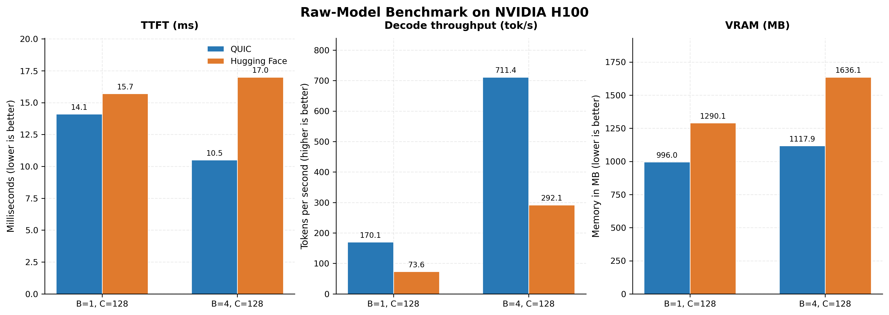
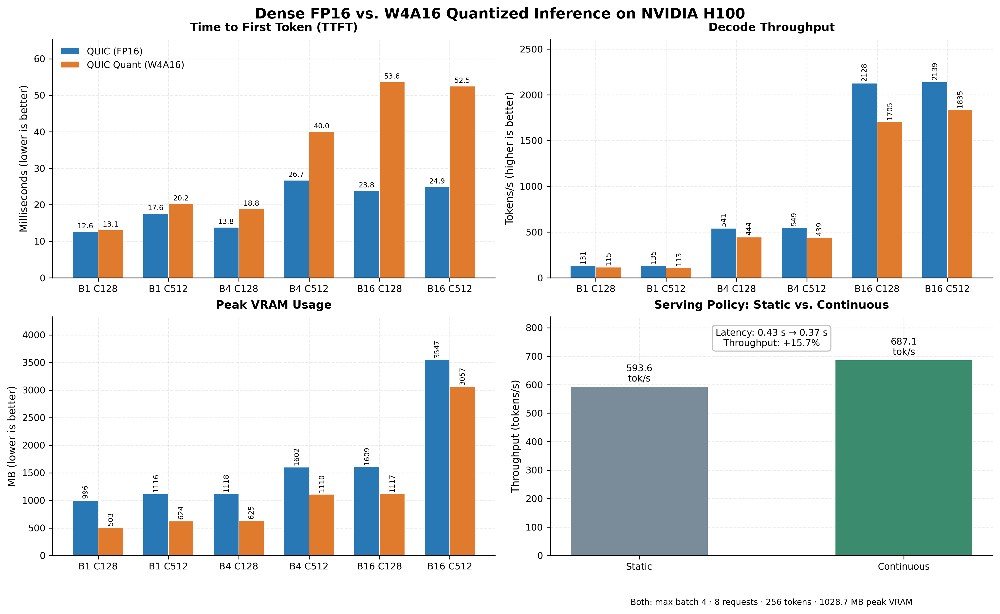
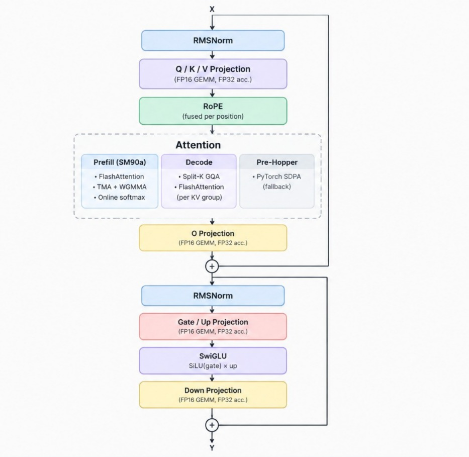

# QUIC — Qwen Unified Inference on CUDA

[](https://developer.nvidia.com/cuda-toolkit)
[](https://www.python.org/)
[](https://huggingface.co/Qwen/Qwen2.5-0.5B)
[](https://huggingface.co/Amr04/Qwen2.5-0.5B-AWQ-W4A16-tied-embed-asym-hq128)
[](LICENSE)

A bare-metal CUDA serving engine for **Qwen2.5-0.5B** built across three core optimization pillars:

1. **Hand-Written CUDA Kernels:** Fused FlashAttention prefill (Hopper TMA/WGMMA), Split-K GQA decode, RMSNorm, RoPE, and SwiGLU to eliminate framework runtime overhead.
2. **Native W4A16 Quantization:** Sub-millisecond 4-bit packed AWQ linear layers via Marlin (sm_75+) and Machete (sm_90a), halving model VRAM footprint.
3. **Continuous Batching:** An iteration-level serving runtime that dynamically schedules waiting requests into active KV-cache slots for high-concurrency throughput.

---

## Performance & Benchmarks (NVIDIA H100)





---

## Table of Contents
- [Key Features](#key-features)
- [Architecture & Kernel Map](#architecture--kernel-map)
- [Quickstart](#quickstart)
  - [1. Prerequisites](#1-prerequisites-local-run)
  - [2. Environment Setup](#2-environment-setup)
  - [3. Model Weights Download](#3-model-weights-download)
- [Generation CLI](#generation-cli)
- [Test Suite & Verification](#test-suite)
- [Benchmarks](#benchmarks)
- [Command-Line Arguments Reference](#command-line-arguments-reference)

---

## Key Features

- **4 Explicit Execution Paths:**
  1. `quic`: Hand-written CUDA kernels in FP16 (Flash Prefill + Split-K Decode + cuBLASLt GEMM + fused RMSNorm/RoPE/SwiGLU).
  2. `quic_quant`: Hand-written CUDA kernels with W4A16 packed weights via **Marlin** (sm_75 to sm_90) and **Machete** (sm_90a WGMMA).
  3. `hf`: Stock Hugging Face eager execution baseline in FP16.
  4. `hf_quant`: Stock Hugging Face eager execution on dequantized AWQ weights.
- **Continuous Batching Runtime:** True multi-request FIFO scheduler, dynamic KV-cache slot admission, and per-token decode loop.
- **Operator Fusion:** Vectorized 16-byte load RMSNorm sustaining ~170 GB/s (>88% of theoretical peak), precomputed trigonometric RoPE tables, and fused SiLU * up activation.
- **Zero-Transformers Mode:** Lightweight `FastTokenizer` powered directly by `tokenizers` for framework-free inference.
- **Hybrid Local & Cloud Compute:** Run locally on your own GPU or scale onto Modal cloud GPUs (`L4`, `H100`) with automatic environment bootstrapping.

---

## Architecture & Kernel Map



| Stage | Kernel | Source File | Optimization |
| :--- | :--- | :--- | :--- |
| **RMSNorm** | `qwen2_rmsnorm_kernel` | `kernels/cuda/rmsnorm.cu` | Vectorized 16-byte loads + warp-shuffle reduction |
| **RoPE** | `qwen2_rope_kernel` | `kernels/cuda/rope.cu` | Precomputed on-device trig tables + per-row position strides |
| **Linear (FP16)** | `cublasGemmEx` + fused bias | `kernels/cuda/gemm.cu` | cuBLASLt with fused FP32 bias addition |
| **Linear (W4A16)** | `marlin_mm` / `machete_mm` | `kernels/cuda/marlin.cu` | 4-bit packed weights + runtime register dequantization |
| **SwiGLU** | `swiglu_naive_half_kernel`| `kernels/cuda/swiglu.cu` | Elementwise SiLU(gate) * up in FP32 with FP16 output |
| **Prefill Attention** | `tma_fa2_pingpong_kernel` | `kernels/cuda/flash_attn_prefill.cu` | Hopper TMA async bulk copies + WGMMA tensor cores |
| **Decode Attention** | `fad_decode_kernel` | `kernels/cuda/flash_attn_decode.cu` | Split-K GQA with left-padding clamping |
| **Sampling** | `argmax_kernel` | `kernels/cuda/sampler.cu` | Fused greedy argmax |

---

## Quickstart

### 1. Prerequisites (Local Run)
* NVIDIA GPU (Compute Capability $\ge$ sm_75: Turing, Ampere, Ada Lovelace, Hopper).
* CUDA Toolkit and C++ compiler:
  ```bash
  sudo apt update && sudo apt install -y build-essential ninja-build git
  ```

### 2. Environment Setup
```bash
# Clone the repository
git clone <repo_url>
cd quic

# Create and activate virtual environment
python3 -m venv .venv
source .venv/bin/activate

# Install PyTorch matching your CUDA version
pip install torch --index-url https://download.pytorch.org/whl/cu124

# Install dependencies
pip install -r requirements.txt
```

### 3. Model Weights Download
Download weights directly from Hugging Face into a local directory:

```bash
pip install huggingface_hub

# Dense FP16 model
huggingface-cli download Qwen/Qwen2.5-0.5B --local-dir models/Qwen2.5-0.5B

# AWQ 4-bit quantized model (W4A16 Asymmetric)
huggingface-cli download Amr04/Qwen2.5-0.5B-AWQ-W4A16-tied-embed-asym-hq128 --local-dir models/Qwen2.5-0.5B-AWQ
```

> **Model Credits:** The public 4-bit W4A16 asymmetric AWQ model is available on Hugging Face at [`Amr04/Qwen2.5-0.5B-AWQ-W4A16-tied-embed-asym-hq128`](https://huggingface.co/Amr04/Qwen2.5-0.5B-AWQ-W4A16-tied-embed-asym-hq128). Special thanks and credit to [**CaptainLevi04**](https://github.com/CaptainLevi04) on GitHub who quantized and released this model.

---

## Generation CLI

Pass the model path directly via `--model-path` in the CLI command:

### Local GPU Execution
```bash
# 1. Custom QUIC fused engine (FP16)
python run.py --local --path quic --model-path models/Qwen2.5-0.5B --prompt "Explain the theory of relativity:"

# 2. Custom QUIC 4-bit Marlin quantized engine
python run.py --local --path quic_quant --model-path models/Qwen2.5-0.5B-AWQ --prompt "Explain the theory of relativity:"

# 3. Stock Hugging Face FP16 baseline
python run.py --local --path hf --model-path models/Qwen2.5-0.5B --prompt "What is quantum entanglement?"

# 4. Stock Hugging Face on AWQ weights
python run.py --local --path hf_quant --model-path models/Qwen2.5-0.5B-AWQ --prompt "What is quantum entanglement?"
```

### Remote Modal Cloud GPU Execution
If local GPU or PyTorch is not available, run directly on Modal cloud GPUs (weights are pre-cached in persistent volume):

```bash
# Run on Modal L4
python run.py --modal --gpu L4 --path quic --prompt "What is quantum mechanics?"

# Run on Modal H100
python run.py --modal --gpu H100 --path quic_quant --prompt "Explain the theory of relativity:"
```

---

## Test Suite

QUIC includes a test suite covering kernel correctness, scheduler behavior, continuous batching, and parity against Hugging Face.

```bash
# Run all tests locally
python tests/run_tests.py --local --model-path models/Qwen2.5-0.5B --awq-path models/Qwen2.5-0.5B-AWQ

# Run all tests remotely on Modal L4
python tests/run_tests.py --modal --gpu L4

# Run all tests remotely on Modal H100
python tests/run_tests.py --modal --gpu H100
```

### Verified Parity & Test Results (NVIDIA L4 GPU)
```text
tests/test_attention.py::test_prefill_matches_sdpa_with_left_padding[2] PASSED
tests/test_attention.py::test_prefill_matches_sdpa_with_left_padding[64] PASSED
tests/test_attention.py::test_prefill_matches_sdpa_with_left_padding[128] PASSED
tests/test_attention.py::test_decode_matches_sdpa_with_left_padding[16] PASSED
tests/test_attention.py::test_decode_matches_sdpa_with_left_padding[64] PASSED
tests/test_attention.py::test_decode_matches_sdpa_with_left_padding[256] PASSED
tests/test_engine.py::test_engine_empty_run PASSED
tests/test_engine.py::test_engine_multirequest_generation[static] PASSED
tests/test_engine.py::test_engine_multirequest_generation[continuous] PASSED
tests/test_kernels.py::test_rmsnorm PASSED
tests/test_kernels.py::test_swiglu PASSED
tests/test_kernels.py::test_gemm PASSED
tests/test_kernels.py::test_sampler PASSED
tests/test_parity.py::test_logits_max_absolute_difference PASSED
tests/test_parity.py::test_first_100_tokens_word_for_word_parity PASSED
tests/test_quant.py::test_marlin_linear_binding PASSED
tests/test_scheduler.py::test_static_scheduler_admits_when_empty PASSED
tests/test_scheduler.py::test_static_scheduler_blocks_while_any_running PASSED
tests/test_scheduler.py::test_continuous_scheduler_admits_into_vacant_slots PASSED

============================= 19 passed in 40.38s ==============================
```

* **Parity:** Mean logits absolute difference is `0.010445`.
* **Accuracy:** Next-token argmax is 100% identical.
* **100-Token Greedy Generation:** 100% exact word-for-word identity between QUIC and stock Hugging Face.

---

## Benchmarks

Run automated sweeps measuring Time-To-First-Token (TTFT), Decode Tokens Per Second (TPS), and Peak VRAM across all 4 execution paths and batching policies:

```bash
# Run locally (4-path sweep + batching comparison)
python benchmarks/run.py --local --paths all --batching both --model-path models/Qwen2.5-0.5B --awq-path models/Qwen2.5-0.5B-AWQ

# Run on Modal H100 GPU
python benchmarks/run.py --modal --gpu H100 --paths quic,quic_quant,hf,hf_quant --batch-sizes 1,4,16 --context-lengths 128,512 --batching both
```

Results are saved to `results/benchmark_results.json` and formatted as a Markdown report in `results/REPORT.md`.

---

## Command-Line Arguments Reference

| Argument | Description | Default |
| :--- | :--- | :--- |
| `--path` | Execution path: `quic`, `quic_quant`, `hf`, `hf_quant` | `quic` |
| `--prompt` | Input prompt text for generation | `"The capital of France is"` |
| `--max-tokens` | Number of tokens to generate | `32` |
| `--model-path` | Path to dense FP16 model weights directory | `/weights/Qwen2.5-0.5B` |
| `--awq-path` | Path to AWQ 4-bit model weights directory | `/weights/Qwen2.5-0.5B-AWQ` |
| `--tokenizer-path`| Path to tokenizer directory | Same as `--model-path` |
| `--batching` | Benchmark serving engine batching: `none`, `static`, `continuous`, `both` | `none` |
| `--local` | Run on local CUDA GPU | Auto-detected |
| `--modal` | Run on Modal cloud GPU | Auto-detected |
| `--gpu` | Modal GPU type: `L4`, `H100`, `A100` | `L4` |

---

## Citation

```bibtex
@software{quic2026,
  author = {Dahroug, H.},
  title = {QUIC: Qwen Unified Inference on CUDA},
  year = {2026},
  url = {https://github.com/hdahroug/ddq}
}
```
